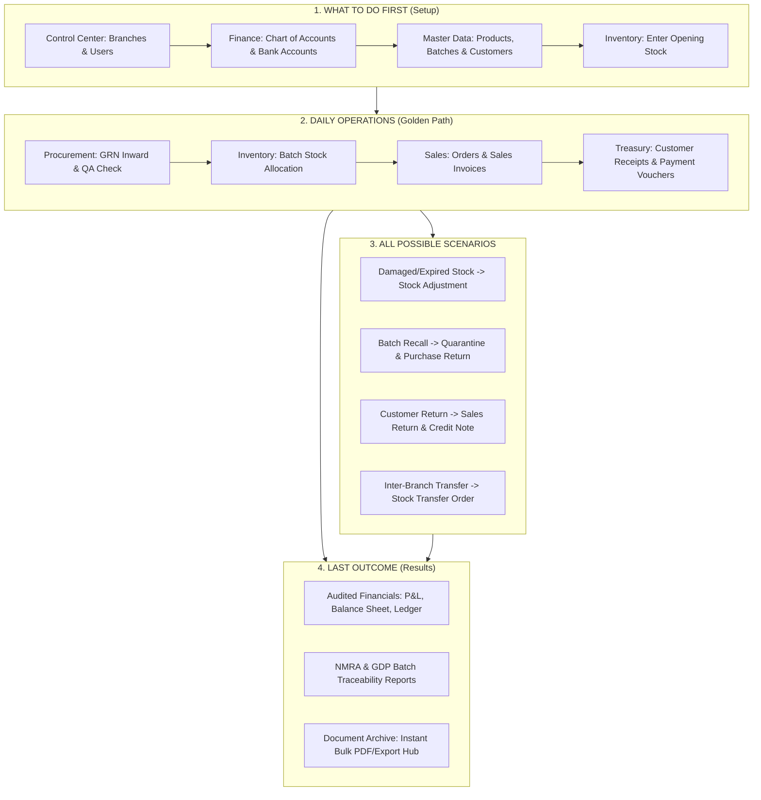

# Ceylon Med Global Pharma ERP — Complete User Guide & Workflow Manual

Welcome to the **Ceylon Med Global Pharma ERP**. This system is an end-to-end enterprise platform built specifically for pharmaceutical wholesale, distribution, and manufacturing compliance in Sri Lanka. It combines **Good Distribution Practice (GDP)**, **NMRA compliance**, **batch-level cold chain tracking**, **double-entry financial accounting**, and **AI-powered workflow automation**.

This document is written in simple, clear steps to guide you on:
1. **What you need to do FIRST** (Initial Setup)
2. **Day-to-Day Operations** (The core daily workflows)
3. **All Scenarios That Can Happen** (Handling every operational situation)
4. **The LAST Outcome** (The final reports, financial statements, and compliance audits)

---

## 🗺️ System Overview At A Glance



---

## Part 1: What You Need To Do FIRST (Initial Setup)

When launching or setting up a new installation, follow this exact sequence:

### Step 1: Setup Branches and Warehouses
* **Where**: `Control Center -> Branches`
* **What to do**:
  1. Add your Head Office and Central Medical Depot.
  2. Add regional warehouses or retail/hospital dispensing branches (e.g., Colombo Central, Kandy Regional, Galle Hub).
  3. Set temperature control capabilities for each warehouse (e.g., Cold Room 2°C–8°C, Ambient 15°C–25°C).

### Step 2: Create Users, Roles & Permissions
* **Where**: `Control Center -> Users & Access`
* **What to do**:
  1. Create accounts for your staff: Pharmacists, Warehouse Officers, Cashiers, Sales Reps, and Accountants.
  2. Assign appropriate role privileges (e.g., only Pharmacists/QA can release quarantined batches; only Finance can approve Payment Vouchers).
  3. *Tip*: Use the **✨ AI Auto-Fill** button on the user creation form to instantly scaffold roles and contact data.

### Step 3: Establish the Chart of Accounts & Bank Accounts
* **Where**: `Finance -> Chart of Accounts` & `Finance -> Bank Accounts`
* **What to do**:
  1. Confirm your Asset, Liability, Equity, Income, and Expense accounts.
  2. Add your corporate bank accounts (e.g., Commercial Bank, Hatton National Bank, Sampath Bank) with account numbers, currency, and opening ledger balances.
  3. Register physical Cheque Books (`Finance -> Cheque Books`) to track cheque leaves automatically.

### Step 4: Register Products, Dosages & Suppliers
* **Where**: `Inventory -> Products` and `Invoice Center -> Customers`
* **What to do**:
  1. Register all pharmaceutical products with:
     - Generic Chemical Name (e.g., *Paracetamol 500mg*, *Amoxicillin 250mg*)
     - NMRA Registration Number & Schedule (e.g., Schedule II Prescription, OTC)
     - Unit of Measure (Box, Blister, Vial, Bottle)
     - Maximum Retail Price (MRP) and Wholesale Wholesale Price
  2. Add your certified distributors, manufacturers, hospitals, and pharmacies.

### Step 5: Enter Opening Stock (Go-Live Inventory)
* **Where**: `Inventory -> Opening Stock`
* **What to do**:
  1. For existing physical stock on hand, record each Batch Number, Expiry Date, Warehouse Location, and Cost Price.
  2. Verify that physical quantities match your system count.
  3. Post the opening stock entry. This automatically credits Opening Stock Equity/Inventory Reserve and establishes real-time stock levels.

---

## Part 2: Day-to-Day Operations (The Core Daily Cycle)

Once the system is set up, daily operations follow this streamlined cycle:

```
[Inward Stock: GRN] ──> [QA Inspection] ──> [Sales Order] ──> [Tax Invoice] ──> [Payment Collection]
```

### Flow 1: Receiving Stock from Suppliers (Procurement)
1. **Create Goods Receipt Note (GRN)**:
   - Go to `Inventory -> Goods Receipt Notes (GRN) -> New GRN`.
   - Select Supplier, PO Reference, and receiving warehouse.
   - Enter Batch Numbers, Manufacturing Dates, and Expiry Dates.
   - *AI Assistant*: Click **✨ AI Auto-Fill** and choose *Cold-Chain Vaccine Consignment* or *Standard Pharmaceutical Inward* to fill batches instantly.
2. **Quarantine & QA Release**:
   - Stock arrives in **Quarantine** status.
   - Responsible Pharmacist checks temperature data logs and batch test certificates.
   - When verified, approve the GRN to transfer stock from Quarantine into Active Sellable Stock.
3. **Pay the Supplier**:
   - Go to `Finance -> Payment Vouchers -> Create Voucher`.
   - Link the GRN/Vendor Bill and issue a Cheque or Bank Transfer (SLIPS/CEFT).

### Flow 2: Selling & Distributing Products (Sales)
1. **Take Orders / Issue Quotes**:
   - Go to `Invoice Center -> Sales Orders -> New Sales Order`.
   - Select the Customer (Pharmacy or Hospital).
   - Add medicines. The system enforces **FEFO (First-Expiry, First-Out)** so the earliest expiring valid batches are reserved automatically.
2. **Issue Tax Invoice**:
   - Go to `Invoice Center -> Sales Invoices -> Create Invoice`.
   - Convert from Sales Order or create directly.
   - The invoice calculates VAT/SSCL taxes, displays batch numbers, and prints with NMRA compliance details.
3. **Collect Customer Payment**:
   - Go to `Invoice Center -> Customer Receipts -> New Receipt`.
   - Match payments against outstanding invoices (supports Cash, Bank Transfer, or Cheque).
   - Once submitted, customer receivables decrease and bank/cash ledger balances update in real-time.

---

## Part 3: All Operational Scenarios You Can Encounter

Here is how the system handles every situation and operational variation:

### Scenario 1: Damaged, Broken, or Expired Drugs Found on Shelves
* **Problem**: Stock in the warehouse is past expiry or damaged in transit.
* **System Action**:
  1. Go to `Inventory -> Stock Adjustments -> New Adjustment`.
  2. Select the specific Batch Number and Warehouse.
  3. Choose Reason: `Damaged`, `Expired`, or `Spillage`.
  4. Enter the negative quantity.
  5. *Accounting Impact*: System debits **Stock Loss/Inventory Expiry Expense** and credits **Inventory Asset**. The affected batch is immediately removed from sellable inventory.

### Scenario 2: Regulatory Recall of a Defective Batch (NMRA Directive)
* **Problem**: The NMRA or manufacturer issues a safety recall on a specific batch (e.g., *Batch #AB-9012*).
* **System Action**:
  1. Go to `Inventory -> Products & Batches`, locate the batch, and toggle status to **QUARANTINE / RECALLED**.
  2. No salesperson or invoice can select or dispatch this batch anymore.
  3. Go to `Inventory -> Purchase Returns -> New Return`.
  4. Select the supplier, pick the recalled batch, and print the return debit documentation.
  5. *Accounting Impact*: Creates a Debit Note against the supplier for full reimbursement.

### Scenario 3: Customer Returns Medicines (Unsold or Damaged by Carrier)
* **Problem**: A hospital pharmacy returns 20 vials that arrived with damaged packaging.
* **System Action**:
  1. Go to `Inventory -> Sales Returns -> New Return`.
  2. Enter the original Invoice Number and select the returned batch.
  3. Inspect condition:
     - If intact and cold chain unbroken -> return to Sellable Stock.
     - If damaged -> divert to Quarantine / Disposal Bin.
  4. Go to `Invoice Center -> Credit Notes -> Create Credit Note`.
  5. *Accounting Impact*: Customer's balance is credited, and Sales Returns account is debited.

### Scenario 4: Customer Exceeds Credit Limit or Has Overdue Invoices
* **Problem**: A pharmacy orders LKR 500,000 worth of stock, but their credit limit is LKR 300,000 or they have 60-day unpaid bills.
* **System Action**:
  1. The system alerts the sales rep immediately on the Sales Order screen with a **Credit Warning**.
  2. The invoice cannot be finalized without Admin override or partial receipt.
  3. The finance team creates a **Customer Receipt** to settle older bills before releasing new stock dispatches.

### Scenario 5: Transferring Stock Between Branches or Depots
* **Problem**: Kandy Regional Warehouse has run out of Insulin, but Colombo Central has surplus.
* **System Action**:
  1. Go to `Inventory -> Stock Transfers -> New Transfer`.
  2. Select Source: *Colombo Central Depot*, Destination: *Kandy Regional*.
  3. Add the product, batch number, and dispatched units.
  4. Stock enters **In-Transit** status.
  5. Once the delivery truck arrives in Kandy and the cold-chain temperature logger is verified, the Kandy depot manager clicks **Receive & Confirm**. Stock is added to Kandy's active balance.

### Scenario 6: Customer Cheque Bounced or Returned Unpaid
* **Problem**: A cheque collected for an invoice fails clearance at the bank.
* **System Action**:
  1. Go to `Finance -> Journal Entries -> New Journal Entry`.
  2. Debit Customer Accounts Receivable and Credit Bank Account with memo *"Cheque #004521 returned unpaid - NSF"*.
  3. The customer invoice balance returns to unpaid status, and recovery workflows trigger.

### Scenario 7: Purchasing Capital Equipment (Freezers, Delivery Vans)
* **Problem**: The company purchases a new walk-in cold-room freezer for LKR 2,500,000.
* **System Action**:
  1. Go to `Finance -> Fixed Assets -> New Asset`.
  2. Enter asset description, serial number, cost price, salvage value, and useful life (e.g., 5 years / straight-line).
  3. Link to a Payment Voucher.
  4. The system calculates monthly depreciation journals automatically.

---

## Part 4: What is the LAST Outcome of the System?

What does the management, auditor, and regulatory body receive at the end of the day, month, and year?

### 1. Fully Audited Financial Statements
* **Profit & Loss Statement (P&L)**: Real-time calculation of gross revenue, Cost of Goods Sold (FIFO/Weighted Average), operating expenses, and net profit.
* **Balance Sheet**: Accurate valuation of Current Assets (Inventory, Bank, AR), Fixed Assets, Current Liabilities (Vendor AP), and Equity.
* **Trial Balance & General Ledger**: Every single invoice, receipt, and stock movement has an auditable debit and credit trail.

### 2. NMRA & GDP Regulatory Compliance Portfolio
* **Batch Traceability (Cradle-to-Grave)**: Enter any batch number to see when it was manufactured, which supplier delivered it, which QA officer inspected it, temperature logs in storage, which sales invoices dispatched it, and which pharmacy or hospital received it.
* **Controlled Substance Register**: Accurate reconciliation of Schedule II/Narcotic pharmaceuticals with zero unaccounted variances.

### 3. Document Archive & Bulk Compliance Export
* **Where**: `Control Center -> Dashboard -> Document Archive & Compliance Export Center`
* **What you get**:
  - Download individual official signed PDF/TXT documents for any invoice, GRN, receipt, or payment voucher.
  - One-click **"Download All Documents"**: Exports a cryptographically verified master compliance bundle containing all business records with SHA-256 integrity hash verification.

---

## ⚡ Quick Reference: Daily Shortcut Cheatsheet

| If you want to... | Go to this page... | Click on... |
| :--- | :--- | :--- |
| Create a Sales Invoice | `Invoice Center -> Sales Invoices` | `+ Create Invoice` (use **✨ AI Auto-Fill** to draft) |
| Receive Supplier Medicines | `Inventory -> Goods Receipt Notes` | `+ New GRN` |
| Collect Customer Money | `Invoice Center -> Customer Receipts` | `+ New Receipt` |
| Pay Supplier or Utility Bill | `Finance -> Payment Vouchers` | `+ Create Voucher` |
| Write off Damaged Medicine | `Inventory -> Stock Adjustments` | `+ New Adjustment` |
| Return Bad Stock to Supplier | `Inventory -> Purchase Returns` | `+ New Return` |
| Send Stock to Another Branch | `Inventory -> Stock Transfers` | `+ New Transfer` |
| See Profit / Balance Sheet | `Finance -> Financial Reports` | Select Report & Date Range |
| Download All Company Records | `Control Center -> Dashboard` | `FolderDown Download All Documents` |
