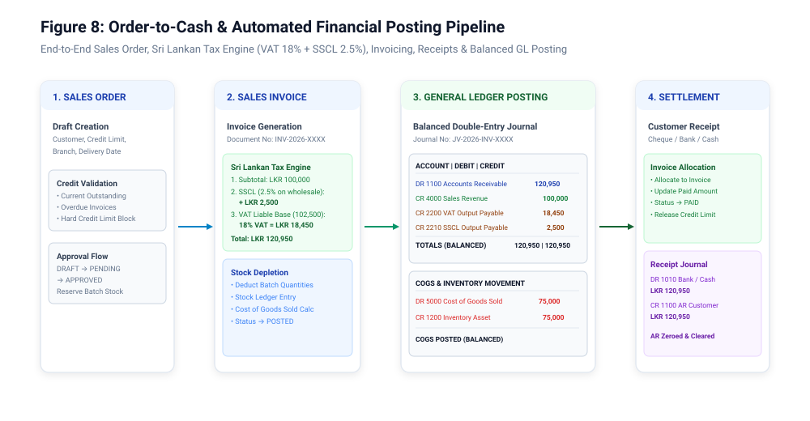

# Pharmacy Distribution ERP — Business Workflows & Operating Procedures

**Document Code:** `DOC-BWF-2026-V1`  
**Target Audience:** Operations Directors, Warehouse Managers, Chief Accountants, Billing Officers, Quality Assurance Engineers  
**Version:** 1.0.0 | **Publication Date:** 2026-10-15  
**Compliance Standards:** WHO Good Distribution Practices (GDP), Sri Lankan NMRA Regulations, Inland Revenue Department (IRD) VAT/SSCL

---

## 1. Overview of Core Business Workflows

The Pharmacy Distribution ERP orchestrates five mission-critical business workflows:
1. **Procure-to-Pay (P2P):** Purchase Orders ➔ Physical GRN & Cold Chain Inspection ➔ Batch Creation ➔ Accounts Payable Posting.
2. **First-Expiry-First-Out (FEFO) Inventory Management:** Putaway ➔ Expiry Sorting ➔ Allocation Priority ➔ Internal Stock Transfers.
3. **Order-to-Cash (O2C):** Sales Orders ➔ Credit Validation ➔ FEFO Picking ➔ Sales Invoice ➔ Sri Lankan Dual-Tax Engine ➔ Dispatch.
4. **Automated Double-Entry Financial Posting:** Real-time Subledger to General Ledger Synchronization and Journal Balancing Invariant ($$\sum Dr = \sum Cr$$).
5. **Pharmaceutical Quarantine & Regulatory Recall:** Defective Lot Isolation ➔ Immediate Dispatch Blocking ➔ Customer Audit Trace ➔ Statutory NMRA Disposal.


---

## 2. Procure-to-Pay (P2P) & Batch Receipt Workflow

### 2.1 Workflow Steps
1. **Purchase Order Issuance:** Purchasing department creates an approved PO to the verified pharmaceutical manufacturer/supplier.
2. **Goods Delivery & Physical Inspection:**
   * Vehicle cold chain temperature dataloggers are verified ($$2^\circ	ext{C} - 8^\circ	ext{C}$$ for vaccines and biologics).
   * Outer packaging, tamper-evident seals, and NMRA registration numbers are inspected.
3. **Goods Receipt Note (GRN) Entry:**
   * Handled at `POST /api/v1/inventory/grns`.
   * For every product received, the warehouse officer inputs:
     - Manufacturer Batch / Lot Number (e.g. `LOT-B-202706`).
     - Manufacturing Date (`mfg_date`) and Expiration Date (`expiry_date`).
     - Received Quantity, Unit Purchase Price, and Statutory Maximum Retail Price (MRP).
4. **GRN Approval & State Transition:**
   * Status transitions from `DRAFT` ➔ `APPROVED`.
   * System initializes `product_batches` record with status `ACTIVE`.
   * Appends an immutable credit record to `stock_ledger_entries` with transaction type `GRN_RECEIPT`.
   * Automatically triggers Accounts Payable journal posting:
     - **DR:** `1200 - Pharmaceutical Inventory Asset`
     - **CR:** `2010 - Accounts Payable (Trade Suppliers)`

---

## 3. FEFO Inventory Management & Batch Expiry Control

Pharmaceutical regulations strictly forbid shipping medicines with less than the minimum statutory remaining shelf life (typically 6 months).


### 3.1 The FEFO Auto-Allocation Algorithm
When an order is placed, the backend query resolves the active batches for the product ordered using the following ordering predicate:

$$	ext{ORDER BY } 	exttt{expiry\_date ASC}, 	exttt{created\_at ASC}$$

```sql
SELECT id, batch_no, expiry_date, available_quantity, unit_price
FROM product_batches
WHERE product_id = ?
  AND company_id = ?
  AND status = 'ACTIVE'
  AND expiry_date > DATE_ADD(CURRENT_DATE, INTERVAL min_shelf_life_days DAY)
  AND (available_quantity - reserved_quantity) > 0
ORDER BY expiry_date ASC, id ASC
FOR UPDATE;
```

### 3.2 Concrete Allocation Example
* **Batch A (Lot A):** Expiry Date: `2027-12-31` | Stock: 5,000 | Status: `ACTIVE`
* **Batch B (Lot B):** Expiry Date: `2027-06-30` | Stock: 1,500 | Status: `ACTIVE`
* **Incoming Customer Order:** 500 units of Amoxicillin 500mg.
* **Allocation Result:** **Batch B** is selected first because its expiry date (`2027-06-30`) precedes Batch A, preventing batch obsolescence and expiry waste.

---

## 4. Order-to-Cash (O2C) & Sri Lankan Tax Calculation



### 4.1 Sales Order & Credit Limit Enforcement
1. Billing officer selects customer (e.g. `Lanka Pharmacy (Pvt) Ltd`).
2. Backend inspects customer's current outstanding balance against approved credit limit:
   $$	ext{Available Credit} = 	ext{Credit Limit} - (	ext{Outstanding Invoices} + 	ext{Pending Orders})$$
3. If order amount exceeds available credit, system blocks approval unless overridden by a Super Admin or Finance Manager with `control:credit_limit:override`.

### 4.2 Sri Lankan Dual-Tax Calculation Engine
Sri Lankan pharmaceutical wholesale transactions are governed by the Inland Revenue Act and statutory gazettes:
1. **SSCL (Social Security Contribution Levy):** Statutory rate of **2.50%** applied on the taxable turnover value.
2. **VAT (Value Added Tax):** Statutory rate of **18.00%** applied on the turnover including SSCL (unless the pharmaceutical item is gazetted as an exempt essential medicine under code `VAT_EXEMPT_PHARMA`).

#### Mathematical Tax Formulation
For a wholesale order with subtotal $$S$$:

$$	ext{SSCL Amount} = S 	imes 0.025$$

$$	ext{VAT Base} = S + 	ext{SSCL Amount} = S 	imes 1.025$$

$$	ext{VAT Amount} = egin{cases} 0.00 & 	ext{if product is VAT Exempt} \ 	ext{VAT Base} 	imes 0.18 & 	ext{if product is Standard VAT} \end{cases}$$

$$	ext{Grand Total} = S + 	ext{SSCL Amount} + 	ext{VAT Amount}$$

#### Real Calculation Example (Verified in Test Suite `FIN-014`)
* **Product Line Subtotal ($$S$$):** LKR 100,000.00
* **SSCL (2.50%):** LKR 2,500.00
* **VAT Base:** LKR 102,500.00
* **VAT (18.00% of LKR 102,500.00):** LKR 18,450.00
* **Invoice Grand Total:** **LKR 120,950.00**

---

## 5. Automated Financial Journal Posting

When a Sales Invoice transitions to `POSTED`, the ERP executes an atomic transaction creating the balancing General Ledger entries:

### 5.1 Sales & Tax Revenue Journal
| Account Code | Account Description | Debit (LKR) | Credit (LKR) |
|---|---|---|---|
| `1100` | Accounts Receivable (Lanka Pharmacy) | 120,950.00 | — |
| `4000` | Pharmaceutical Sales Revenue | — | 100,000.00 |
| `2200` | VAT Output Payable (18%) | — | 18,450.00 |
| `2210` | SSCL Output Payable (2.5%) | — | 2,500.00 |
| **TOTALS** | **BALANCED JOURNAL INVARIANT** | **120,950.00** | **120,950.00** |

### 5.2 Cost of Goods Sold (COGS) & Inventory Depletion Journal
Concurrently, the system records the inventory asset reduction based on the batch purchase cost (e.g. LKR 75,000.00):
| Account Code | Account Description | Debit (LKR) | Credit (LKR) |
|---|---|---|---|
| `5000` | Cost of Goods Sold (COGS) | 75,000.00 | — |
| `1200` | Pharmaceutical Inventory Asset | — | 75,000.00 |
| **TOTALS** | **BALANCED JOURNAL INVARIANT** | **75,000.00** | **75,000.00** |

---

## 6. Pharmaceutical Batch Quarantine & Regulatory Recall Workflow


Under NMRA safety alerts or batch defect reports (e.g. microbial contamination or packaging defects), the Compliance Officer initiates an immediate quarantine:

### 6.1 Step 1: Immediate Batch Hold
1. Navigate to **Compliance Center ➔ Batch Holds**.
2. Select defective batch (e.g. `LOT-Q-202611`) and invoke `POST /api/v1/inventory/product-batches/:id/quarantine`.
3. System updates batch status from `ACTIVE` ➔ `HOLD`.
4. **Immediate Safeguard:** All billing selection queries automatically exclude `HOLD` batches. Any attempt to invoice this batch yields `HTTP 422 Unprocessable Entity ("Batch is quarantined")`.

### 6.2 Step 2: Customer Recall Audit Trace
1. The compliance engine queries `sales_invoice_items` joined with `sales_invoices` and `customers`:
   ```sql
   SELECT c.name, c.phone, c.email, si.invoice_number, si.invoice_date, sii.quantity
   FROM sales_invoice_items sii
   JOIN sales_invoices si ON si.id = sii.sales_invoice_id
   JOIN customers c ON c.id = si.customer_id
   WHERE sii.batch_id = ? AND si.status = 'POSTED';
   ```
2. System generates the **Statutory NMRA Recall Contact List** containing every pharmacy that received units of the quarantined batch.

### 6.3 Step 3: Disposal & Regulatory Write-Off
1. Once stock is returned from the market, stock is moved to the **Quarantine Store**.
2. A formal **Destruction Certificate** is recorded in Compliance Center.
3. Accounting writes off remaining inventory:
   - **DR:** `5100 - Inventory Loss / Damaged Goods Write-off`
   - **CR:** `1200 - Pharmaceutical Inventory Asset`
