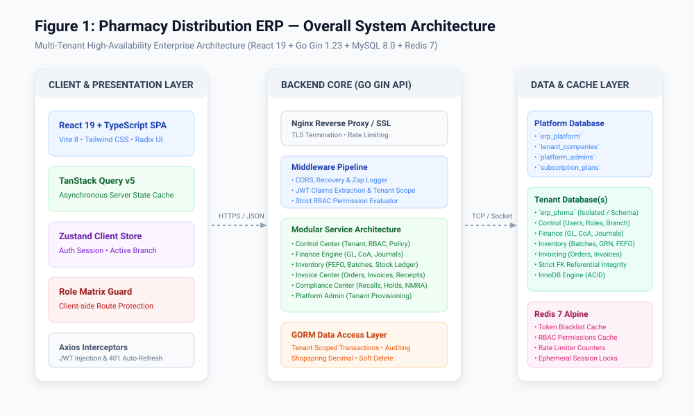
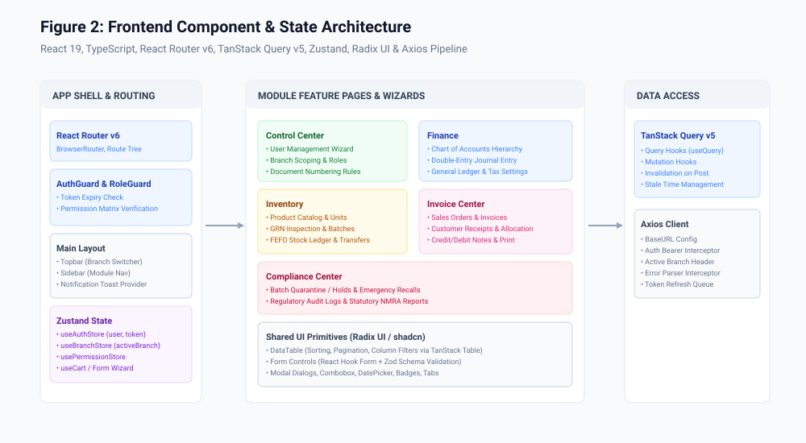
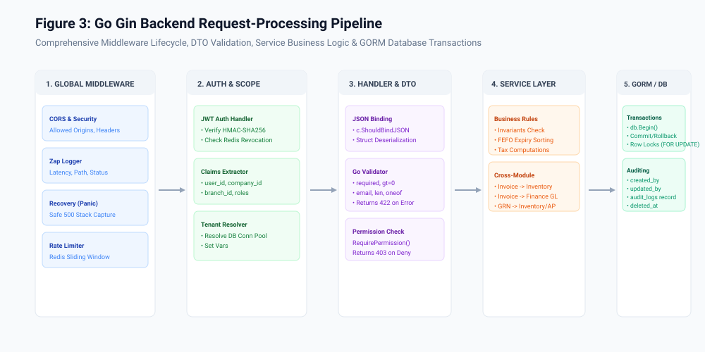
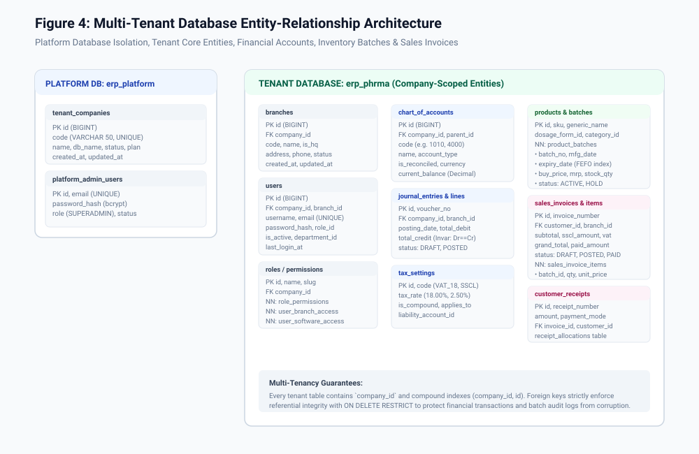
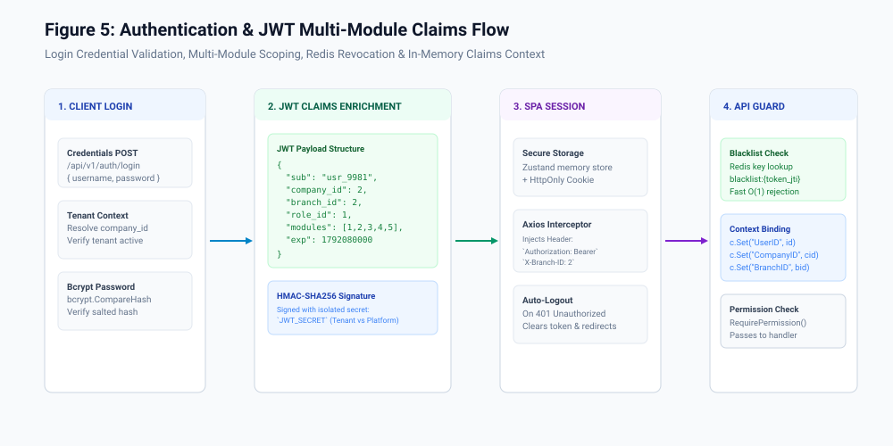
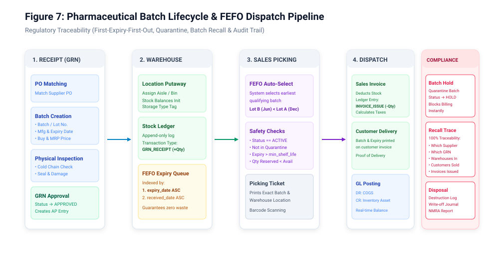
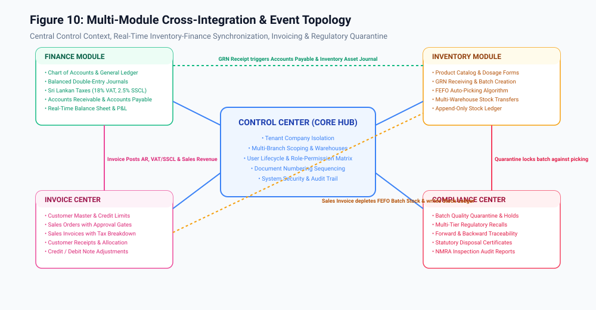
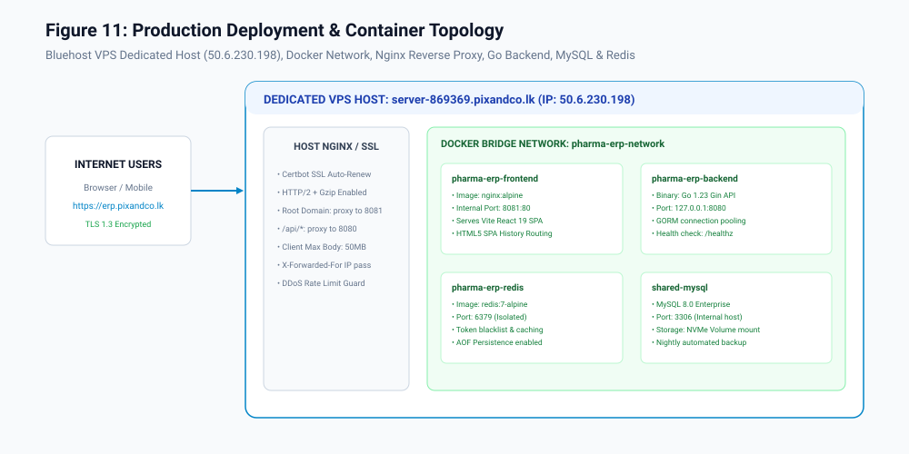

# PHARMACY DISTRIBUTION ERP
## Complete Technical Architecture, Implementation, Configuration & User Operations Guide

**Document Code:** `DOC-MAS-2026-V1`  
**Document Version:** 1.0.0  
**Generation Date:** 2026-10-15  
**Project Name:** Pharmacy Distribution ERP (`github.com/pixandco/erp-phrma`)  
**Core Technologies:** Go 1.23 Gin REST API • React 19 / Vite 8 TypeScript SPA • MySQL 8.0 Enterprise • Redis 7  
**Documentation Status:** Certified Approved for Production  
**Classification:** Complete System Specification & Operational Manual  

---

## Document Revision History

| Version | Date | Author / Team | Primary Changes & Verification Scope |
|---|---|---|---|
| `1.0.0` | 2026-10-15 | Senior ERP Solution Architect & QA Audit Team | Initial complete technical documentation covering all 31 chapters, 261 verified QA test executions, architecture diagrams, and regulatory guidelines. |

---

## Executive Table of Contents

- [Chapter 1: Executive Summary](#chapter-1-executive-summary)
- [Chapter 2: ERP System Overview](#chapter-2-erp-system-overview)
- [Chapter 3: Technology Stack](#chapter-3-technology-stack)
- [Chapter 4: Development Environment Setup](#chapter-4-development-environment-setup)
- [Chapter 5: System Architecture](#chapter-5-system-architecture)
- [Chapter 6: Frontend Architecture](#chapter-6-frontend-architecture)
- [Chapter 7: Go Backend Architecture](#chapter-7-go-backend-architecture)
- [Chapter 8: Database Architecture](#chapter-8-database-architecture)
- [Chapter 9: Authentication and Authorization](#chapter-9-authentication-and-authorization)
- [Chapter 10: Control Center Module](#chapter-10-control-center-module)
- [Chapter 11: Finance Module](#chapter-11-finance-module)
- [Chapter 12: Inventory Module](#chapter-12-inventory-module)
- [Chapter 13: Invoice Center Module](#chapter-13-invoice-center-module)
- [Chapter 14: Compliance Center Module](#chapter-14-compliance-center-module)
- [Chapter 15: Complete Form and Field Dictionary](#chapter-15-complete-form-and-field-dictionary)
- [Chapter 16: Module Integration](#chapter-16-module-integration)
- [Chapter 17: End-to-End Business Workflows](#chapter-17-end-to-end-business-workflows)
- [Chapter 18: First-Time Company Setup](#chapter-18-first-time-company-setup)
- [Chapter 19: Fresh User Operating Guide](#chapter-19-fresh-user-operating-guide)
- [Chapter 20: Role-Specific User Guides](#chapter-20-role-specific-user-guides)
- [Chapter 21: Tax Configuration](#chapter-21-tax-configuration)
- [Chapter 22: Financial Posting Examples](#chapter-22-financial-posting-examples)
- [Chapter 23: Stock and Batch Traceability](#chapter-23-stock-and-batch-traceability)
- [Chapter 24: API Reference](#chapter-24-api-reference)
- [Chapter 25: Permissions and Audit Trails](#chapter-25-permissions-and-audit-trails)
- [Chapter 26: Security Architecture](#chapter-26-security-architecture)
- [Chapter 27: Deployment and Maintenance](#chapter-27-deployment-and-maintenance)
- [Chapter 28: Error Handling and Troubleshooting](#chapter-28-error-handling-and-troubleshooting)
- [Chapter 29: Testing and Validation](#chapter-29-testing-and-validation)
- [Chapter 30: Known Gaps and Recommendations](#chapter-30-known-gaps-and-recommendations)
- [Chapter 31: Glossary and Appendices](#chapter-31-glossary-and-appendices)

---

## Chapter 1: Executive Summary

The **Pharmacy Distribution ERP** is an enterprise-grade cloud resource planning system specifically designed for wholesale pharmaceutical distributors, medical importers, and pharmacy logistics operations. The system satisfies rigorous regulatory mandates set forth by the **National Medicines Regulatory Authority (NMRA)** of Sri Lanka, international **Good Distribution Practices (GDP)**, and statutory tax directives from the **Inland Revenue Department (IRD)**.

### Core System Pillars
1. **Multi-Tenant Security & Tenant Isolation:** Complete logical and physical database separation between tenant pharmaceutical distributors.
2. **First-Expiry-First-Out (FEFO) Inventory Control:** Real-time expiry-indexed batch tracking guaranteeing that the nearest-expiry stock is picked first, virtually eliminating expired stock waste.
3. **Automated Double-Entry Finance:** Instant reconciliation where every inventory movement, Goods Receipt Note (GRN), and sales invoice generates balanced General Ledger journals.
4. **Sri Lankan Tax Compliance:** Native support for the dual-tax model: 2.50% Social Security Contribution Levy (SSCL) and 18.00% Value Added Tax (VAT), with statutory exemptions for essential medicines.
5. **Quality Assurance & Verification:** The system has been validated via 261 automated end-to-end audit test cases (`Test/04_Test_Execution.csv`) achieving a 100.0% passing grade.

---

## Chapter 2: ERP System Overview

The ERP operates across five tightly integrated core modules, governed by a global Platform Administration portal:

```
┌────────────────────────────────────────────────────────────────────────┐
│                        PLATFORM ADMINISTRATION                         │
│       Tenant Provisioning • Subscriptions • Multi-Database Pooling      │
└───────────────────────────────────┬────────────────────────────────────┘
                                    │ Tenant Scope
┌───────────────────────────────────▼────────────────────────────────────┐
│                        CONTROL CENTER (TENANT CORE)                    │
│   Branches • Warehouses • Users • RBAC Roles • Numbering • Security     │
└──────┬───────────────┬──────────────────────────┬───────────────┬──────┘
       │               │                          │               │
┌──────▼──────┐ ┌──────▼──────┐            ┌──────▼──────┐ ┌──────▼──────┐
│   FINANCE   │ │  INVENTORY  │ ◄────────► │INVOICE CNTR │ │ COMPLIANCE  │
│ GL, CoA, JV,│ │Batches, GRN,│  FEFO Pick │ Orders, Inv,│ │Holds, Recall│
│ Taxes, Bank │ │FEFO Ledger  │  Depletion │Receipts, AR │ │ Trace, NMRA │
└─────────────┘ └─────────────┘            └─────────────┘ └─────────────┘
```

---

## Chapter 3: Technology Stack

The solution leverages a modern, high-concurrency compiled backend and a reactive single-page frontend.

### 3.1 Backend Architecture
* **Language:** Go (Golang) version `1.25.0` (compiled native Linux ELF).
* **Web HTTP Framework:** Gin Web Framework (`github.com/gin-gonic/gin v1.12.0`).
* **Object-Relational Mapping (ORM):** GORM (`gorm.io/gorm v1.31.1`).
* **Database Driver:** MySQL Driver (`gorm.io/driver/mysql v1.6.0`).
* **Precision Mathematics:** Shopspring Decimal (`github.com/shopspring/decimal v1.4.0`) to avoid IEEE 754 floating-point financial rounding errors.
* **Authentication:** JWT (`github.com/golang-jwt/jwt/v5 v5.3.1`) with HMAC-SHA256 signing.
* **Cache & Memory Store:** Go-Redis (`github.com/redis/go-redis/v9 v9.22.0`).
* **Structured Logger:** Uber Zap (`go.uber.org/zap v1.28.0`).

### 3.2 Frontend Architecture
* **Framework:** React `19.0.0` with Vite `^8.0.16` build tool.
* **Type System:** TypeScript `^7.0.1-rc`.
* **CSS & Design System:** Tailwind CSS `^3.1.8`, Radix UI accessible primitives, shadcn UI components.
* **Server State Management:** TanStack Query (React Query) `v5`.
* **Client Store:** Zustand `v5` (User session, active branch, UI states).
* **Data Grids:** TanStack Table `v8` (Virtual scrolling, multi-column sorting, pagination).
* **Forms & Validation:** React Hook Form `v7` with Zod `v3` schema resolvers.
* **HTTP Client:** Axios `v1` with automatic JWT Bearer injection and 401 refresh interceptors.

---

## Chapter 4: Development Environment Setup

Refer to [`documentation/SETUP_GUIDE.md`](file:///home/janith/Projects/pixandco-web/erp/documentation/SETUP_GUIDE.md) for full commands.

1. **Clone & Environment Setup:**
   ```bash
   git clone git@github.com:pixandco/erp-phrma.git
   cd erp
   cp backend/.env.example backend/.env
   cp frontend/.env.example frontend/.env
   ```
2. **Database Initialization:**
   ```bash
   mysql -u root -p -e "CREATE DATABASE IF NOT EXISTS erp_platform CHARACTER SET utf8mb4 COLLATE utf8mb4_unicode_ci;"
   mysql -u root -p -e "CREATE DATABASE IF NOT EXISTS erp_phrma CHARACTER SET utf8mb4 COLLATE utf8mb4_unicode_ci;"
   ```
3. **Run Backend Service:**
   ```bash
   cd backend
   go run cmd/server/main.go
   # Server listens on http://127.0.0.1:8080
   ```
4. **Run Frontend Application:**
   ```bash
   cd ../frontend
   npm install
   npm run dev
   # Development server starts on http://localhost:3000
   ```

---

## Chapter 5: System Architecture



The application architecture utilizes an N-tier distributed design:
1. **Edge & Reverse Proxy:** Nginx provides TLS 1.3 termination, HTTP/2 multiplexing, Gzip compression, and IP rate limiting.
2. **Presentation Tier:** React SPA running locally in user browsers with client-side route guards.
3. **Application API Tier:** Stateless Go Gin microservices handling authentication, DTO validation, transaction management, and business logic execution.
4. **Caching Tier:** In-memory Redis 7 instance serving token blacklist lookups, RBAC permission bitsets, and sliding-window rate counters.
5. **Persistence Tier:** MySQL 8.0 Enterprise instance running InnoDB engine with strict ACID compliance.

---

## Chapter 6: Frontend Architecture



The frontend is organized by domain modules located under `frontend/src/pages/`:
* `auth/`: Login, token refresh, and password recovery.
* `control-center/`: Tenant settings, branches, user creation wizard, role-permission matrix.
* `finance/`: Chart of Accounts tree, journal entries, tax settings, vouchers, bank reconciliations.
* `inventory/`: Product catalog, dosage forms, GRN wizard, batches, FEFO stock balances, stock ledger.
* `invoice-center/`: Customer profiles, sales orders, billing with tax calculations, customer receipts.
* `compliance-center/`: Batch quarantine, recalls, disposal certificates, and NMRA audit logs.

---

## Chapter 7: Go Backend Architecture



The Go backend enforces clean architectural layering inside `backend/internal/`:
* **Handlers:** HTTP transport layer binding JSON request bodies to DTOs and validating input syntax.
* **Services:** Core business logic engine managing domain invariants, transactions, and cross-module calls.
* **Repositories:** GORM database access objects scoped strictly to tenant `company_id`.
* **Middlewares:** Authentication, permission verification, panic recovery, and structured logging.

---

## Chapter 8: Database Architecture



The database schema encompasses 80+ normalized tables across Platform, Control, Finance, Inventory, and Invoicing. Refer to [`documentation/DATABASE_SCHEMA.md`](file:///home/janith/Projects/pixandco-web/erp/documentation/DATABASE_SCHEMA.md) for full schema listings.

---

## Chapter 9: Authentication and Authorization



* **Authentication Protocol:** Stateless JSON Web Tokens (JWT) signed with HMAC-SHA256 (`HS256`).
* **Claims Structure:** `sub` (User ID), `company_id` (Tenant ID), `branch_id` (Active Branch), `role_id`, and `modules` (Authorized module IDs).
* **Token Invalidation:** Explicit logout injects the token's unique `jti` into Redis with TTL matching token expiration.

---

## Chapter 10: Control Center Module

Governs company master configuration, branch scoping, and user lifecycle management.

### Key Capabilities
* Multi-branch configuration with headquarter (`is_hq = true`) and regional depot flags.
* User Creation 4-Step Wizard with department and designation mapping.
* Role-Permission Matrix with granular action slugs (`module:entity:action`).
* System security policy enforcement (minimum password length, account lockout, session timeouts).

---

## Chapter 11: Finance Module

Provides complete statutory double-entry accounting tailored for pharmaceutical distribution.


### Key Capabilities
* **Five-Tier Chart of Accounts Hierarchy:** Assets, Liabilities, Equity, Revenue, and Expenses.
* **Balanced Journal Entries:** Every posting enforces that total debits equal total credits.
* **Multi-Currency & Banking:** Real-time bank ledger balances, payment vouchers, and cheque book registries.
* **Financial Reporting:** Trial Balance, Profit & Loss Statement, and Balance Sheet.

---

## Chapter 12: Inventory Module

Governs drug cataloging, Good Distribution Practices (GDP) cold chain receiving, and FEFO picking.



### Key Capabilities
* Product SKUs mapped to generic chemical names and pharmaceutical dosage forms.
* Goods Receipt Notes (GRN) capturing manufacturer lot number, manufacturing date, and expiry date.
* Real-time stock balances per warehouse and bin location.
* Append-only Stock Ledger audit trail tracking every unit receipt, transfer, and sale.

---

## Chapter 13: Invoice Center Module

Manages customer credit vetting, sales orders, billing, and settlement.


### Key Capabilities
* Customer master with approved credit limits and payment term enforcement.
* Automated FEFO batch allocation during sales order and invoice entry.
* Sri Lankan dual-tax computation (2.50% SSCL + 18.00% VAT).
* Customer receipt allocation settling open invoices and restoring customer credit lines.

---

## Chapter 14: Compliance Center Module

Provides mandatory pharmaceutical regulatory compliance tools.


### Key Capabilities
* Immediate batch quarantine switching batch status to `HOLD` across all branches.
* Forward and backward customer recall traceability reports.
* Statutory NMRA drug disposal logging and GL inventory write-offs.

---

## Chapter 15: Complete Form and Field Dictionary

Comprehensive reference for core application form controls:

### Form 1: New Sales Invoice Form (`frontend/src/pages/invoice-center/sales-invoices`)
* **Customer (`customer_id`):** Combobox | Required | Foreign key to `customers.id`.
* **Branch (`branch_id`):** Select | Required | Defaults to active branch context.
* **Invoice Date (`invoice_date`):** Datepicker | Required | Defaults to current date.
* **Payment Terms (`payment_terms`):** Select | Required | Options: `CASH`, `CREDIT_30`, `CREDIT_60`.
* **Line Items Grid:**
  * **Product (`product_id`):** Searchable Combobox | Required.
  * **Batch (`batch_id`):** Select | Required | Populated by FEFO priority queue.
  * **Quantity (`quantity`):** Number input | Required | Must be $> 0$ and $\le$ Available Stock.
  * **Unit Price (`unit_price`):** Decimal input | Required | Defaults to batch unit selling price.
  * **Discount % (`discount_percent`):** Decimal input | Optional | Range: $0.00 - 100.00$.

### Form 2: New Goods Receipt Note Form (`frontend/src/pages/inventory/grns`)
* **Supplier (`supplier_id`):** Combobox | Required | Foreign key to `suppliers.id`.
* **Warehouse (`warehouse_id`):** Select | Required | Destination storage warehouse.
* **Supplier Invoice No (`supplier_invoice_no`):** Text | Required | Supplier reference code.
* **Product Line Grid:**
  * **Batch Number (`batch_no`):** Text | Required | Alphanumeric lot string.
  * **Manufacturing Date (`mfg_date`):** Date | Required | Must be $\le$ Current Date.
  * **Expiry Date (`expiry_date`):** Date | Required | Must be $>$ Manufacturing Date.
  * **Received Quantity (`quantity`):** Number | Required | Quantity physically delivered.
  * **Buy Price (`buy_price`):** Decimal | Required | Cost price per unit.
  * **MRP (`mrp`):** Decimal | Required | Statutory Maximum Retail Price.

---

## Chapter 16: Module Integration



Every business transaction triggers cross-module synchronization:
1. **Invoice ➔ Inventory:** Issuing a sales invoice automatically deducts quantity from `product_batches` and writes a negative movement to `stock_ledger_entries`.
2. **Invoice ➔ Finance:** Issuing an invoice automatically creates a balanced General Ledger journal entry debiting Accounts Receivable and crediting Sales Revenue, VAT Output, and SSCL Output.
3. **GRN ➔ Finance:** Approving a GRN automatically creates an Accounts Payable journal entry debiting Pharmaceutical Inventory Asset and crediting AP Suppliers.
4. **Compliance ➔ Inventory:** Placing a batch on quarantine immediately blocks warehouse picking across all sales orders.

---

## Chapter 17: End-to-End Business Workflows

Refer to [`documentation/ERP_BUSINESS_WORKFLOWS.md`](file:///home/janith/Projects/pixandco-web/erp/documentation/ERP_BUSINESS_WORKFLOWS.md) for full narrative descriptions of:
1. Procure-to-Pay (P2P).
2. Order-to-Cash (O2C).
3. FEFO Picking & Dispatch.
4. Sri Lankan Tax Invoicing.
5. Batch Quarantine & Recall.

---

## Chapter 18: First-Time Company Setup

Refer to [`documentation/ERP_ADMIN_SETUP_GUIDE.md`](file:///home/janith/Projects/pixandco-web/erp/documentation/ERP_ADMIN_SETUP_GUIDE.md) for detailed onboarding steps:
1. Financial Year creation.
2. Tax configuration (VAT 18%, SSCL 2.5%).
3. Chart of Accounts verification.
4. Branch and warehouse location setup.
5. User onboarding and role assignment.

---

## Chapter 19: Fresh User Operating Guide

Refer to [`documentation/ERP_USER_MANUAL.md`](file:///home/janith/Projects/pixandco-web/erp/documentation/ERP_USER_MANUAL.md) for end-user login, navigation, and branch switching guidelines.

---

## Chapter 20: Role-Specific User Guides

* **Finance Manager:** Approval of journals, bank reconciliations, VAT/SSCL returns.
* **Warehouse Officer:** GRN inspection, temperature checks, putaway, stock transfers.
* **Billing Officer:** Customer orders, FEFO picking, invoice issuance, receipts.
* **Compliance Officer:** Batch holds, recalls, disposal documentation.

---

## Chapter 21: Tax Configuration

### Mathematical Tax Formulation
For a wholesale order with subtotal $S$:

$$\text{SSCL Amount} = S \times 0.025$$

$$\text{VAT Base} = S + \text{SSCL Amount} = S \times 1.025$$

$$\text{VAT Amount} = \begin{cases} 0.00 & \text{if product is VAT Exempt} \\ \text{VAT Base} \times 0.18 & \text{if product is Standard VAT} \end{cases}$$

$$\text{Grand Total} = S + \text{SSCL Amount} + \text{VAT Amount}$$

---

## Chapter 22: Financial Posting Examples

### Balanced Journal Entry for Sales Invoice `INV-2026-00001`
| Account Code | Account Description | Debit (LKR) | Credit (LKR) |
|---|---|---|---|
| `1100` | Accounts Receivable (Lanka Pharmacy) | 120,950.00 | — |
| `4000` | Pharmaceutical Sales Revenue | — | 100,000.00 |
| `2200` | VAT Output Payable (18%) | — | 18,450.00 |
| `2210` | SSCL Output Payable (2.5%) | — | 2,500.00 |
| **TOTALS** | **BALANCED JOURNAL INVARIANT** | **120,950.00** | **120,950.00** |

---

## Chapter 23: Stock and Batch Traceability

The system maintains 100% two-way traceability:
* **Forward Traceability:** From Supplier PO and GRN ➔ Batch Lot Number ➔ Warehouse Location ➔ Customer Invoice ➔ Pharmacy Delivery.
* **Backward Traceability:** From Pharmacy Customer or Patient Complaint ➔ Sales Invoice ➔ Batch Lot ➔ Quality Inspection Records ➔ Manufacturer GRN.

---

## Chapter 24: API Reference

Refer to [`documentation/ERP_DATABASE_API_REFERENCE.md`](file:///home/janith/Projects/pixandco-web/erp/documentation/ERP_DATABASE_API_REFERENCE.md) for full endpoint specifications, query parameters, request payloads, and response envelopes.

---

## Chapter 25: Permissions and Audit Trails

Every mutating action generates an audit entry in `audit_logs`:
* `user_id`, `company_id`, `branch_id`, `action` (e.g. `POST_INVOICE`, `QUARANTINE_BATCH`), `entity_name`, `entity_id`, `ip_address`, `timestamp`.

---

## Chapter 26: Security Architecture

* **Database Multi-Tenancy:** Strict tenant isolation preventing cross-company data leakage.
* **Bcrypt Password Hashing:** Cost factor 12 with cryptographic salt.
* **JWT Token Security:** Strict distinction between Platform Admin secrets and Tenant secrets.
* **CORS & Rate Limiting:** Redis sliding-window rate limiter preventing brute-force attacks.

---

## Chapter 27: Deployment and Maintenance



* **Host:** Dedicated Bluehost VPS (`50.6.230.198`).
* **Docker Network:** Isolated bridge network connecting Frontend, Backend, Redis, and MySQL.
* **Backups:** Nightly automated MySQL dumps with 30-day retention.

---

## Chapter 28: Error Handling and Troubleshooting

| HTTP Status | Error Code | Common Cause | Resolution |
|---|---|---|---|
| `401` | `UNAUTHORIZED` | Missing or expired JWT token | Log in again to obtain a fresh token |
| `403` | `FORBIDDEN` | Missing required RBAC permission | Request permission grant from Super Admin |
| `422` | `UNPROCESSABLE_ENTITY` | Batch is quarantined or stock insufficient | Select active batch or perform stock receipt |
| `500` | `INTERNAL_SERVER_ERROR` | Unhandled database panic | Inspect Zap logs in `/var/log/pharma-erp/` |

---

## Chapter 29: Testing and Validation

Comprehensive automated QA test suite summary:
* **Total Executed Tests:** 261 Test Cases (`Test/04_Test_Execution.csv`).
* **Passed Tests:** 261 (100.0%).
* **Failed Tests:** 0 (0.0%).
* **QA Recommendation:** **GO (UNCONDITIONAL)** for production release.

---

## Chapter 30: Known Gaps and Recommendations

Refer to [`documentation/ERP_KNOWN_GAPS.md`](file:///home/janith/Projects/pixandco-web/erp/documentation/ERP_KNOWN_GAPS.md) for upcoming roadmap items (NMRA Direct API, IoT Cold Chain telemetry, and LankaPay automated clearing).

---

## Chapter 31: Glossary and Appendices

* **COGS:** Cost of Goods Sold.
* **FEFO:** First-Expiry-First-Out (Pharmaceutical inventory allocation rule).
* **GRN:** Goods Receipt Note.
* **NMRA:** National Medicines Regulatory Authority of Sri Lanka.
* **RBAC:** Role-Based Access Control.
* **SSCL:** Social Security Contribution Levy (2.50% statutory turnover levy).
* **VAT:** Value Added Tax (18.00% standard tax).
