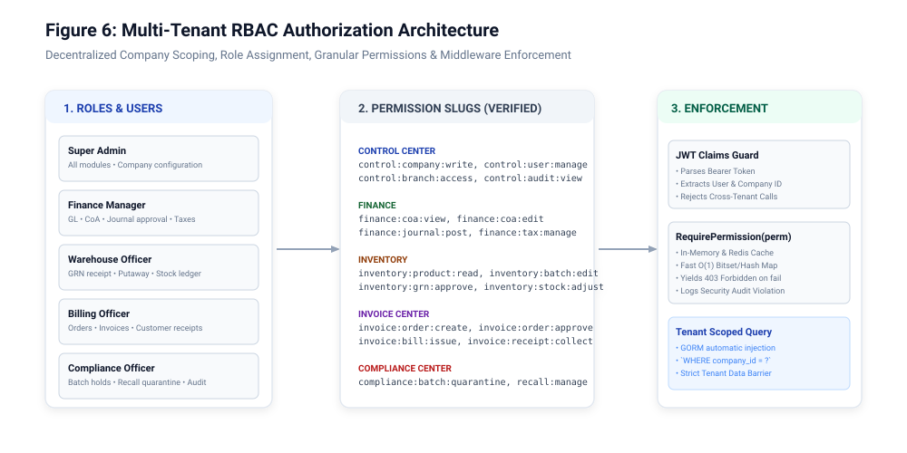
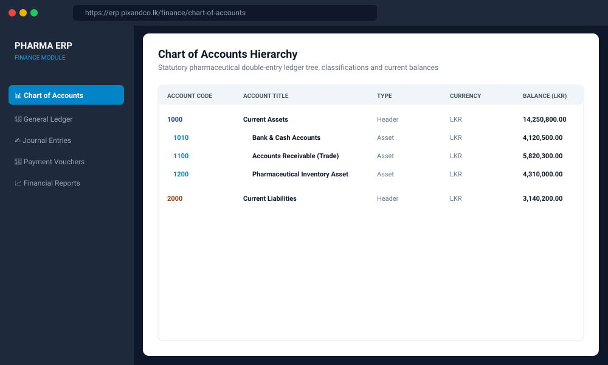
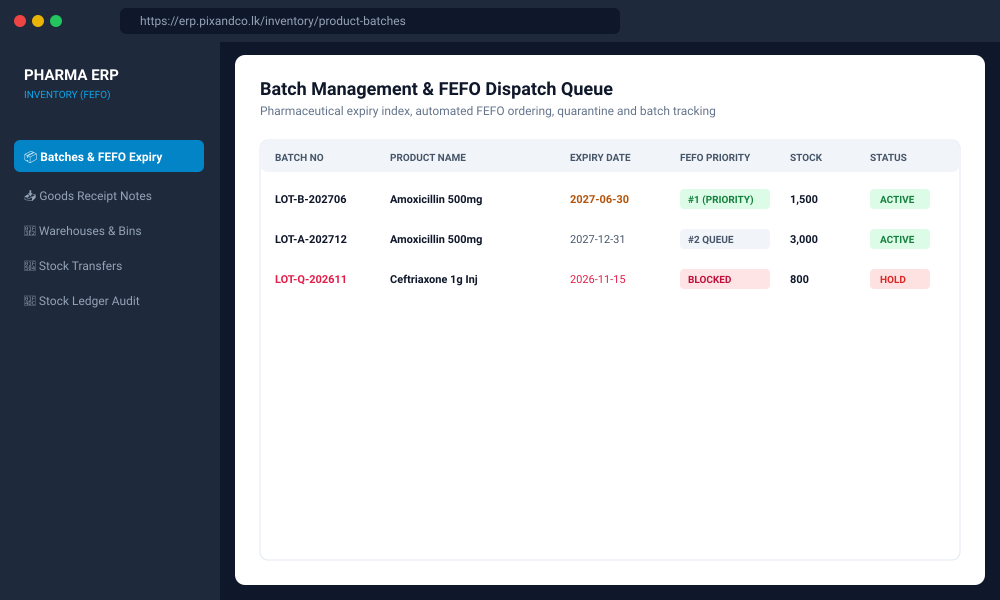
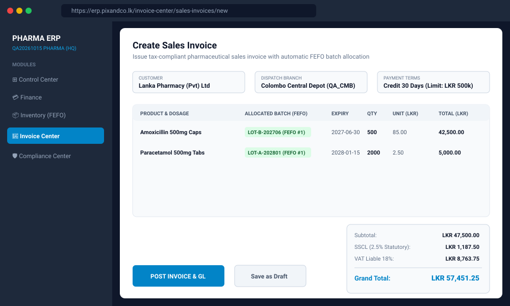
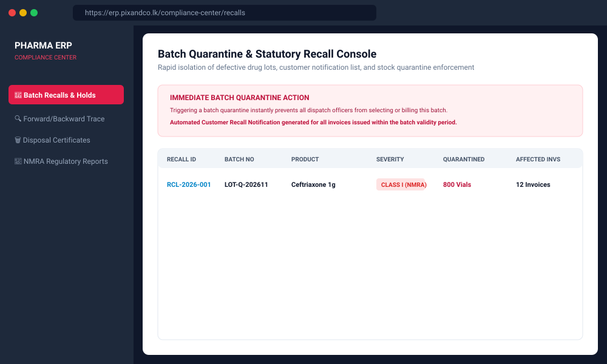

# Pharmacy Distribution ERP — Comprehensive End-User Operating Manual

**Document Code:** `DOC-USR-2026-V1`  
**Target Roles:** Billing Officers, Warehouse Keepers, Purchasing Officers, Accountants, Compliance Officers  
**Version:** 1.0.0 | **Publication Date:** 2026-10-15  
**Application URL:** `https://erp.pixandco.lk`

---

## 1. Getting Started & Logging In

### 1.1 First-Time Login
1. Open Google Chrome or any modern web browser and navigate to `https://erp.pixandco.lk`.
2. Enter your assigned **Username** or **Corporate Email** and initial password provided by the System Administrator.
3. Click **Sign In**.
4. Upon successful sign-in, the system loads your active role profile and accessible modules.

### 1.2 Switching Active Branches
Pharmaceutical inventory, orders, and local bank accounts are scoped by operational branch:
* In the application top header bar, click the **Branch Selector Dropdown**.
* Select the branch you are actively stationed at (e.g. `Colombo Central (QA_CMB)` or `Kandy Depot (QA_KDY)`).
* All subsequent stock balances, picking queues, and billing documents will automatically scope to your active branch.

---

## 2. Module 1: Control Center User Guide

The Control Center manages organizational structures, branches, users, and security settings.

### 2.1 Managing Users
* **Path:** `Control Center ➔ Users`
* **Create New User:**
  1. Click **+ Add User** button to launch the User Creation Wizard.
  2. Fill in Full Name, Email, Username, Temporary Password, Designation, and Department.
  3. Select allowed branch access permissions.
  4. Assign the appropriate security role (e.g. `Billing Officer`, `Warehouse Officer`).
  5. Select permitted software modules.
  6. Click **Save User**.

---

## 3. Module 2: Finance Module User Guide

The Finance module handles the Chart of Accounts, general ledger, journals, bank accounts, vouchers, and Sri Lankan taxes.

### 3.1 Recording a Manual Journal Entry
* **Path:** `Finance ➔ Journal Entries ➔ New Entry`
* **Form Fields & Procedures:**
  1. **Posting Date:** Select transaction date (must fall within an active financial year).
  2. **Reference / Memo:** Enter descriptive explanation (e.g. *Monthly Warehouse Rent Colombo Hub*).
  3. **Line Items Grid:**
     * Line 1: Select Debit Account (e.g. `5200 - Rent Expense`), enter Debit Amount (e.g. `150,000.00`).
     * Line 2: Select Credit Account (e.g. `1010 - Bank Current Account`), enter Credit Amount (e.g. `150,000.00`).
  4. **Validation Check:** The system verifies the Invariant: $\sum \text{Debit} == \sum \text{Credit}$. If debits do not match credits, the **Post** button remains disabled.
  5. Click **Post Journal**.

### 3.2 Bank Reconciliation
* **Path:** `Finance ➔ Bank Reconciliations`
* Compare internal ledger book balance with your bank statement. Mark cleared cheques and verify closing reconciled balances.

---

## 4. Module 3: Inventory & FEFO Batch Management User Guide

The Inventory module governs pharmaceutical products, dosage forms, cold chain putaway, Goods Receipt Notes (GRN), and FEFO batch dispatch.

### 4.1 Creating a Goods Receipt Note (GRN)
* **Path:** `Inventory ➔ Goods Receipt Notes ➔ New GRN`
* **Receiving Procedure:**
  1. Select **Supplier / Manufacturer** and enter Supplier Invoice / Delivery Note Number.
  2. Select Destination Warehouse (e.g. `QA_MAIN Central Cold Chain`).
  3. In the product lines, select the medicine (e.g. `Amoxicillin 500mg Capsules`).
  4. Enter the **Batch Number** printed on the drug carton (e.g. `LOT-B-202706`).
  5. Enter **Manufacturing Date** and **Expiry Date**.
  6. Enter Received Quantity, Unit Purchase Cost, and Maximum Retail Price (MRP).
  7. Confirm cold-chain temperature status ($2^\circ\text{C} - 8^\circ\text{C}$).
  8. Click **Submit GRN for Approval**.
  9. Upon approval by the Warehouse Manager, stock is immediately added to available inventory and becomes eligible for FEFO picking.

### 4.2 Stock Transfers Between Depots
* **Path:** `Inventory ➔ Stock Transfers ➔ New Transfer`
* Select Source Branch/Warehouse and Target Regional Depot.
* Choose specific batches to transfer and quantity.
* Click **Dispatch Transfer**. The target branch accepts the incoming shipment upon physical delivery.

---

## 5. Module 4: Invoice Center User Guide

The Invoice Center handles customer masters, sales orders, automated FEFO sales invoicing, and customer receipt settlement.

### 5.1 Creating a Sales Invoice
* **Path:** `Invoice Center ➔ Sales Invoices ➔ New Invoice`
* **Step-by-Step Billing:**
  1. Select **Customer** (e.g. `Lanka Pharmacy (Pvt) Ltd`). The customer's credit limit and current balance are displayed.
  2. Select active **Dispatch Branch**.
  3. Add items to invoice. For each product:
     * The system automatically suggests the earliest expiring batch under **FEFO** rules.
     * Enter quantity to sell.
     * The system calculates unit price, line discounts, and tax applicability.
  4. **Tax Summary Display:**
     * Product Subtotal.
     * SSCL (2.50% statutory levy).
     * VAT (18.00% standard VAT on qualifying taxable turnover).
     * Grand Total Payable.
  5. Click **Post Invoice & GL**.
  6. The invoice is generated with a QR code and printable tax-compliant invoice format, stock is depleted from the batch, and general ledger journals are updated in real-time.

### 5.2 Collecting a Customer Receipt
* **Path:** `Invoice Center ➔ Customer Receipts ➔ New Receipt`
* Select Customer, Payment Mode (Cash, Cheque, Bank Transfer), and Cheque Reference.
* Enter Amount Received.
* Allocate received funds against outstanding invoices (FIFO or manual allocation).
* Click **Confirm Receipt**. The customer's credit balance is immediately released.

---

## 6. Module 5: Compliance Center User Guide

The Compliance Center provides tools for pharmaceutical batch quarantine, recall management, and regulatory compliance.

### 6.1 Executing an Emergency Batch Quarantine
* **Path:** `Compliance Center ➔ Batch Holds`
* **Procedure:**
  1. Search for defective batch number (e.g. `LOT-Q-202611`).
  2. Click **Quarantine Batch**.
  3. Provide quarantine reason (e.g. *NMRA Alert #2026/04: Packaging Defect*).
  4. Confirm action.
  5. **Immediate Result:** The batch status switches to `HOLD`. All sales orders containing this batch are flagged, and billing officers cannot dispatch or bill the affected units.

### 6.2 Generating Customer Recall Lists
* **Path:** `Compliance Center ➔ Recalls ➔ Generate Recall List`
* Enter the quarantined Batch ID.
* The system generates an immediate report detailing:
  * Invoices issued containing this batch.
  * Customer Name, Telephone, and Delivery Address.
  * Exact quantities delivered to each pharmacy.
* Export report to Excel / PDF for regulatory submission to the NMRA and customer recall phone outreach.
