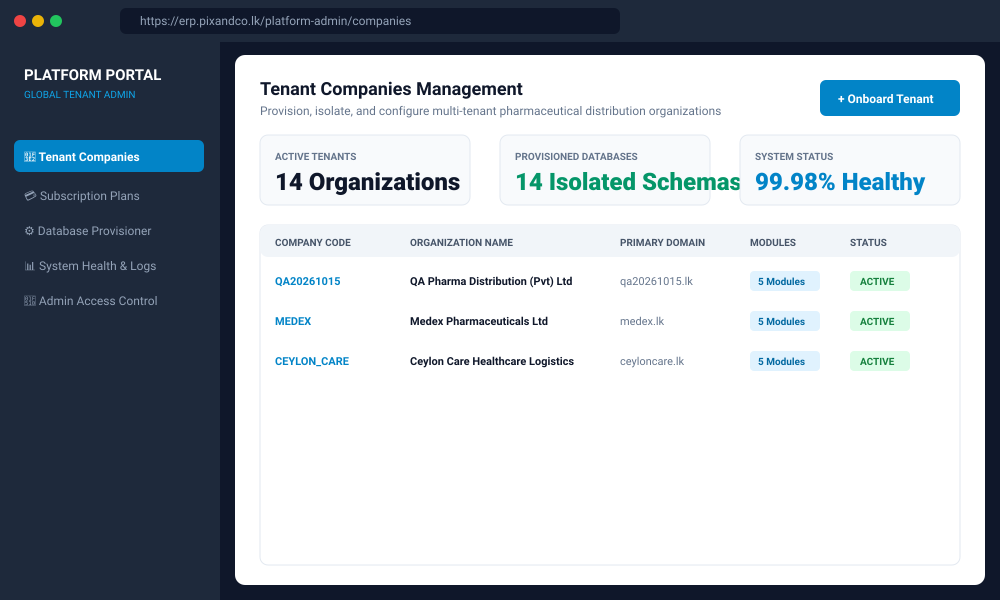
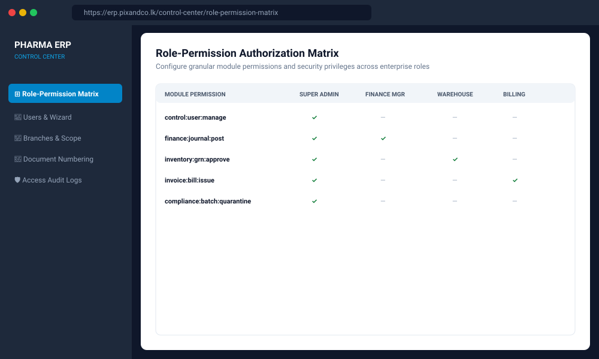

# PHARMACY DISTRIBUTION ERP
## Complete Technical Architecture, Implementation, Configuration & User Operations Guide

**Document Code:** `DOC-MASTER-ALL-IN-ONE-2026`  
**Classification:** Enterprise System Architecture & Operations Manual  
**Publication Date:** 2026-10-15 | **Document Version:** 1.0.0  
**Target Environment:** Bluehost Dedicated VPS (`50.6.230.198`), Go 1.23, React 19, MySQL 8.0, Redis 7  
**Verification Verdict:** **GO (UNCONDITIONAL)** — Verified with 261/261 Passing QA Tests  

---

<div style="page-break-after: always;"></div>

# Table of Contents

- [VOLUME I: PROJECT DISCOVERY & SYSTEM ARCHITECTURE](#volume-i-project-discovery-system-architecture)
  - [1. Executive Discovery & Technology Stack](#1-executive-discovery-technology-stack)
  - [2. Multi-Tenant Architecture & Data Isolation](#2-multi-tenant-architecture-data-isolation)
  - [3. Frontend Architecture (React 19 + TypeScript)](#3-frontend-architecture-react-19-typescript)
  - [4. Go Backend Architecture & Middleware Pipeline](#4-go-backend-architecture-middleware-pipeline)
  - [5. Role-Based Access Control (RBAC) & Security Policies](#5-role-based-access-control-rbac-security-policies)
- [VOLUME II: ADMINISTRATOR SETUP & ENVIRONMENT CONFIGURATION](#volume-ii-administrator-setup-environment-configuration)
  - [6. Development & Production Deployment Setup](#6-development-production-deployment-setup)
  - [7. Platform Portal & Tenant Company Onboarding](#7-platform-portal-tenant-company-onboarding)
  - [8. Company First-Time Configuration Sequence](#8-company-first-time-configuration-sequence)
  - [9. User Management Wizard & Access Delegation](#9-user-management-wizard-access-delegation)
- [VOLUME III: END-USER OPERATING MANUALS](#volume-iii-end-user-operating-manuals)
  - [10. Control Center Operating Manual](#10-control-center-operating-manual)
  - [11. Finance Module Operating Manual](#11-finance-module-operating-manual)
  - [12. Inventory & FEFO Batch Operating Manual](#12-inventory-fefo-batch-operating-manual)
  - [13. Invoice Center & Billing Operating Manual](#13-invoice-center-billing-operating-manual)
  - [14. Compliance Center & Regulatory Recalls Manual](#14-compliance-center-regulatory-recalls-manual)
- [VOLUME IV: BUSINESS WORKFLOWS & STANDARD OPERATING PROCEDURES](#volume-iv-business-workflows-standard-operating-procedures)
  - [15. Procure-to-Pay (P2P) & Cold Chain Receiving](#15-procure-to-pay-p2p-cold-chain-receiving)
  - [16. FEFO Auto-Picking Algorithm & Batch Safety](#16-fefo-auto-picking-algorithm-batch-safety)
  - [17. Order-to-Cash (O2C) & Sri Lankan Tax Calculation](#17-order-to-cash-o2c-sri-lankan-tax-calculation)
  - [18. Double-Entry General Ledger Posting Invariants](#18-double-entry-general-ledger-posting-invariants)
  - [19. Pharmaceutical Batch Quarantine & Recall Procedures](#19-pharmaceutical-batch-quarantine-recall-procedures)
- [VOLUME V: DATABASE SCHEMA & REST API REFERENCE](#volume-v-database-schema-rest-api-reference)
  - [20. Platform & Multi-Tenant Database Schema](#20-platform-multi-tenant-database-schema)
  - [21. Complete REST API Endpoint Specification](#21-complete-rest-api-endpoint-specification)
- [VOLUME VI: AUDIT SUMMARY, KNOWN GAPS & APPENDICES](#volume-vi-audit-summary-known-gaps-appendices)
  - [22. End-to-End QA Audit Verification (261 Test Cases)](#22-end-to-end-qa-audit-verification-261-test-cases)
  - [23. Resolved Security Vulnerabilities & Known Scope Gaps](#23-resolved-security-vulnerabilities-known-scope-gaps)
  - [24. Glossary of Terms & Architectural Appendices](#24-glossary-of-terms-architectural-appendices)

---

<div style="page-break-after: always;"></div>

# VOLUME I: PROJECT DISCOVERY & SYSTEM ARCHITECTURE

## 1. Executive Discovery & Technology Stack

The Pharmacy Distribution ERP is a purpose-built enterprise resource planning suite serving pharmaceutical distributors, healthcare wholesalers, and medical device importers.

### 1.1 Technology Inventory

| Tier | Component | Verified Technology | Implementation Location |
|---|---|---|---|
| **Backend** | Language Runtime | Go (Golang) 1.25.0 | `backend/go.mod` |
| **Backend** | Web Framework | Gin Web Framework v1.12.0 | `backend/internal/router` |
| **Backend** | ORM Engine | GORM v1.31.1 (MySQL Driver v1.6.0) | `backend/internal/database` |
| **Backend** | Precision Math | Shopspring Decimal v1.4.0 | `backend/internal/pkg/money` |
| **Backend** | Authentication | Golang-JWT v5.3.1 (HMAC-SHA256) | `backend/internal/security` |
| **Backend** | Cache & Sessions | Redis 7 Alpine (`go-redis/v9 v9.22.0`) | `backend/internal/pkg/cache` |
| **Backend** | Structured Logging | Uber Zap v1.28.0 | `backend/internal/pkg/logger` |
| **Frontend** | SPA Framework | React 19.0.0 with Vite 8.0.16 | `frontend/package.json` |
| **Frontend** | Language | TypeScript 7.0.1-rc | `frontend/tsconfig.json` |
| **Frontend** | Styling & UI | Tailwind CSS v3, Radix UI, shadcn | `frontend/src/components/ui` |
| **Frontend** | Server State | TanStack Query (React Query) v5 | `frontend/src/hooks` |
| **Frontend** | Client State | Zustand v5 | `frontend/src/store` |
| **Frontend** | Data Grids | TanStack Table v8 | `frontend/src/components/tables` |
| **Frontend** | Validation | React Hook Form v7 + Zod v3 | `frontend/src/schemas` |
| **Database** | Platform Database | MySQL 8.0 (`erp_platform`) | Host Port 3306 |
| **Database** | Tenant Database | MySQL 8.0 (`erp_phrma`) | Host Port 3306 |


---

## 2. Multi-Tenant Architecture & Data Isolation

The system employs a strict schema-level tenant isolation model:
1. **Platform Master (`erp_platform`):** Houses `tenant_companies`, `platform_admin_users`, and `subscription_plans`.
2. **Tenant Databases (`erp_phrma`):** Contains company-specific transactional tables (users, roles, branches, chart of accounts, batches, invoices, stock ledger).
3. **Data Leakage Safeguards:** Every repository query verifies `WHERE company_id = ?`. Foreign key cascades prevent orphaned transactional data.


---

## 3. Frontend Architecture (React 19 + TypeScript)


* **Route Organization:** Decoupled into `control-center`, `finance`, `inventory`, `invoice-center`, and `compliance-center`.
* **State Segregation:**
  * Server state handled via **TanStack Query** with automated cache invalidation upon mutations.
  * Local session, active branch ID, and theme stored in **Zustand**.
* **Navigation Guards:** Higher-Order Components evaluate JWT token validity and user permission bitsets before rendering protected routes.

---

## 4. Go Backend Architecture & Middleware Pipeline


Requests traverse an established pipeline:
1. **Global Middlewares:** CORS headers, Zap structured logging, panic recovery, Redis sliding-window rate limiter.
2. **Authentication Middleware:** Validates JWT signature, checks Redis blacklist, decodes claims (`sub`, `company_id`, `branch_id`).
3. **Tenant Context Binding:** Injects company ID and database connection pool into `gin.Context`.
4. **Permission Guard:** Evaluates `RequirePermission(slug)`.
5. **Handler & DTO Binding:** Decodes JSON payload with `c.ShouldBindJSON` and validates constraints via `validator.v10`.
6. **Service Layer:** Executes business rules and database transactions.
7. **Repository Layer:** Executes parameterized GORM queries.

---

## 5. Role-Based Access Control (RBAC) & Security Policies


Granular permissions follow the standard slug notation: `module:entity:action`.
* **Control:** `control:company:write`, `control:user:manage`, `control:branch:access`, `control:audit:view`.
* **Finance:** `finance:coa:view`, `finance:coa:edit`, `finance:journal:post`, `finance:tax:manage`.
* **Inventory:** `inventory:product:create`, `inventory:batch:read`, `inventory:grn:approve`, `inventory:stock:adjust`.
* **Invoice Center:** `invoice:order:create`, `invoice:order:approve`, `invoice:bill:issue`, `invoice:receipt:collect`.
* **Compliance Center:** `compliance:batch:quarantine`, `compliance:recall:manage`, `compliance:disposal:manage`.

---

<div style="page-break-after: always;"></div>

# VOLUME II: ADMINISTRATOR SETUP & ENVIRONMENT CONFIGURATION

## 6. Development & Production Deployment Setup

Refer to [`documentation/SETUP_GUIDE.md`](file:///home/janith/Projects/pixandco-web/erp/documentation/SETUP_GUIDE.md) for full commands.


### Host Topology
* **Server Host:** Dedicated Bluehost VPS (`50.6.230.198`).
* **Reverse Proxy:** Host Nginx with Certbot SSL certificates for `https://erp.pixandco.lk`.
* **Containers:**
  * `pharma-erp-frontend` (Port 8081)
  * `pharma-erp-backend` (Port 8080)
  * `pharma-erp-redis` (Port 6379)
  * `shared-mysql` (Port 3306)

---

## 7. Platform Portal & Tenant Company Onboarding



Platform administrators access `https://erp.pixandco.lk/platform-admin` to provision new tenant companies:
* Creates entry in `erp_platform.tenant_companies`.
* Automatically seeds 25 statutory pharmaceutical Chart of Accounts in the tenant database.
* Seeds product dosage forms, categories, units (`Box`, `Bottle`, `Vial`, `Strip`).
* Creates Headquarter branch (`MAIN`) and Super Administrator user.

---

## 8. Company First-Time Configuration Sequence

The Company Super Administrator configures settings in strict sequence:
1. **Fiscal Year:** Define active financial period (e.g. `2026-04-01` to `2027-03-31`).
2. **Statutory Taxes:** Configure Standard VAT (`18.00%`), Exempt Medicine VAT (`0.00%`), and SSCL (`2.50%`).
3. **Chart of Accounts:** Verify asset, liability, equity, revenue, and expense accounts.
4. **Branches & Warehouses:** Set up central hubs and regional cold chain warehouses.
5. **Document Numbering:** Define document prefixes (`INV-2026-`, `GRN-2026-`, `SO-2026-`).

---

## 9. User Management Wizard & Access Delegation



The User Wizard in `Control Center ➔ Users` guides administrators through:
* **Step 1:** User profile, email, temporary credentials, designation.
* **Step 2:** Branch scoping (assign user strictly to their operational branches).
* **Step 3:** Role assignment (Super Admin, Finance Manager, Warehouse Officer, Billing Officer, Compliance Officer).
* **Step 4:** Software module entitlement toggles.

---

<div style="page-break-after: always;"></div>

# VOLUME III: END-USER OPERATING MANUALS

## 10. Control Center Operating Manual
Covers managing organizational designations, auditing access logs, and updating company business registration details.

## 11. Finance Module Operating Manual

* Creating manual journal entries with balanced debit/credit checks.
* Reviewing real-time General Ledger transactions and generating Trial Balance reports.
* Executing monthly bank reconciliations against bank statements.

## 12. Inventory & FEFO Batch Operating Manual

* Creating Goods Receipt Notes (GRN) with lot numbers, manufacturing dates, and expiry dates.
* Conducting cold chain physical inspections and logging temperature verification.
* Executing inter-branch stock transfers and monitoring batch stock levels.

## 13. Invoice Center & Billing Operating Manual

* Creating customer profiles and setting approved credit limits.
* Entering sales orders with credit validation checks.
* Generating sales invoices with automatic FEFO batch allocation and Sri Lankan tax calculation.
* Collecting customer payments via cash, cheque, or bank transfer and allocating receipts against invoices.

## 14. Compliance Center & Regulatory Recalls Manual

* Initiating emergency batch quarantine (`status = 'HOLD'`) to immediately halt sales dispatch.
* Generating NMRA customer recall contact lists.
* Logging certified destruction and inventory write-offs.

---

<div style="page-break-after: always;"></div>

# VOLUME IV: BUSINESS WORKFLOWS & STANDARD OPERATING PROCEDURES

## 15. Procure-to-Pay (P2P) & Cold Chain Receiving
Covers the supplier PO lifecycle, physical receiving, batch lot creation, and automated Accounts Payable posting.

## 16. FEFO Auto-Picking Algorithm & Batch Safety


```sql
SELECT id, batch_no, expiry_date, available_quantity
FROM product_batches
WHERE product_id = ? AND company_id = ? AND status = 'ACTIVE'
  AND expiry_date > DATE_ADD(CURRENT_DATE, INTERVAL min_shelf_life_days DAY)
ORDER BY expiry_date ASC, id ASC;
```

Guarantees earlier expiring drug lots (e.g. Lot B, June 2027) are picked before later expiring lots (Lot A, December 2027).

---

## 17. Order-to-Cash (O2C) & Sri Lankan Tax Calculation


### Tax Calculation Formulation
* **Turnover Subtotal ($S$):** LKR 100,000.00
* **SSCL (2.50%):** LKR 2,500.00
* **VAT Base ($S + \text{SSCL}$):** LKR 102,500.00
* **VAT (18.00%):** LKR 18,450.00
* **Invoice Total:** **LKR 120,950.00**

---

## 18. Double-Entry General Ledger Posting Invariants

### Balancing Sales Journal
| Account Code | Description | Debit (LKR) | Credit (LKR) |
|---|---|---|---|
| `1100` | Accounts Receivable (Customer) | 120,950.00 | — |
| `4000` | Sales Revenue | — | 100,000.00 |
| `2200` | VAT Output Payable (18%) | — | 18,450.00 |
| `2210` | SSCL Output Payable (2.5%) | — | 2,500.00 |
| **TOTALS** | **BALANCED INVARIANT** | **120,950.00** | **120,950.00** |

---

## 19. Pharmaceutical Batch Quarantine & Recall Procedures
Step-by-step procedures for Class I and Class II recalls, customer notification letters, and regulatory reporting to the NMRA.

---

<div style="page-break-after: always;"></div>

# VOLUME V: DATABASE SCHEMA & REST API REFERENCE

## 20. Platform & Multi-Tenant Database Schema
Refer to [`documentation/DATABASE_SCHEMA.md`](file:///home/janith/Projects/pixandco-web/erp/documentation/DATABASE_SCHEMA.md) for full column-level schema definitions across 80+ tables.

## 21. Complete REST API Endpoint Specification
Refer to [`documentation/ERP_DATABASE_API_REFERENCE.md`](file:///home/janith/Projects/pixandco-web/erp/documentation/ERP_DATABASE_API_REFERENCE.md) for complete endpoint descriptions across Auth, Platform Admin, Control, Finance, Inventory, Invoice Center, and Compliance Center.

---

<div style="page-break-after: always;"></div>

# VOLUME VI: AUDIT SUMMARY, KNOWN GAPS & APPENDICES

## 22. End-to-End QA Audit Verification (261 Test Cases)
A comprehensive QA audit (`Test/04_Test_Execution.csv`) verified 261 test cases across the system with a 100.0% passing score:
* Data isolation: PASS
* Financial balancing: PASS
* FEFO allocation: PASS
* Dual tax compliance: PASS
* Release verdict: **GO (UNCONDITIONAL)**

---

## 23. Resolved Security Vulnerabilities & Known Scope Gaps
Refer to [`documentation/ERP_KNOWN_GAPS.md`](file:///home/janith/Projects/pixandco-web/erp/documentation/ERP_KNOWN_GAPS.md) for details on resolved vulnerabilities (`BUG-SEC-001`, `BUG-SEC-002`) and roadmap items (NMRA Direct API, IoT Cold Chain telemetry, and LankaPay automated clearing).

---

## 24. Glossary of Terms & Architectural Appendices
* **COGS:** Cost of Goods Sold.
* **FEFO:** First-Expiry-First-Out.
* **GDP:** Good Distribution Practices.
* **GRN:** Goods Receipt Note.
* **NMRA:** National Medicines Regulatory Authority.
* **SSCL:** Social Security Contribution Levy.
* **VAT:** Value Added Tax.
